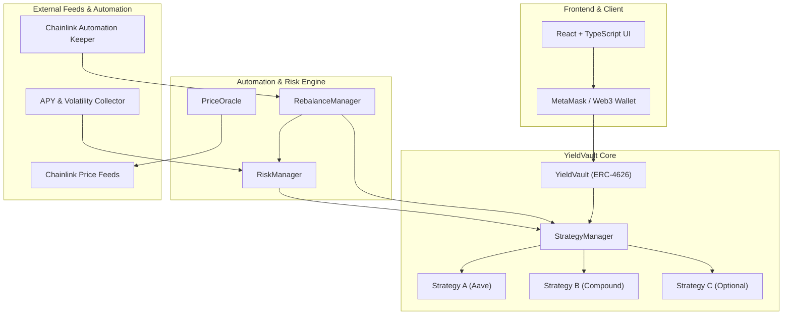

# YieldPilot Architecture & 6-Stage Implementation Report

This report outlines the end-to-end design, implementation, and test verification for the five major feature additions across all six stages requested for **YieldPilot**.

---

## 1. Executive Summary & Architecture

The completed implementation bridges smart contracts, Chainlink oracle feeds, risk engines, and keepers:

---

## 2. Stage Breakdown & Implementation

### Stage 1: Automated Rebalancing Engine (`RebalanceManager.sol`)
- **Location**: `contracts/contracts/rebalancing/RebalanceManager.sol`
- **Core Functions**:
  - `setTargetAllocation(address[] strategies, uint256[] targetWeightsBps, uint256 reserveTargetBps)`
  - `setTargetAllocation(uint256[] targetWeights)`
  - `calculateRebalance() returns (int256[] memory differences)`
  - `checkRebalance() returns (bool required)`
  - `executeRebalance()`
- **Threshold & Safety Controls**:
  - `rebalanceThresholdBps` (default 500 BPS / 5%): Rebalancing only triggers when strategy allocation deviations exceed this threshold, preventing unnecessary gas expenditure.
  - `minRebalanceInterval` (cooldown): Enforces a minimum time window between automated rebalances.
  - Enforces reserve floor: Target reserve cannot be less than `StrategyManager.reserveBps()`.
  - Enforces allocation caps: Target strategy weight cannot exceed `StrategyManager.allocationCapBps(strategy)`.

---

### Stage 2: Chainlink Price Feeds (`PriceOracle.sol`)
- **Location**: `contracts/contracts/oracle/PriceOracle.sol`
- **Chainlink Standard**: `AggregatorV3Interface.sol`
- **Features**:
  - Multi-asset feed registry (`priceFeeds[asset]`).
  - Strict validations:
    - `price > 0`
    - `updatedAt > 0`
    - `block.timestamp - updatedAt <= maxPriceAge` (feed freshness)
    - `answeredInRound >= roundId` (avoids stale rounds)
  - Normalized pricing: standardizes 8-decimal, 18-decimal, and custom feed decimals into standardized 8-decimal USD values.
  - `getAssetValueInUSD(address asset, uint256 amount)` adjusts for token decimals to compute true USD portfolio NAV.

---

### Stage 3: Real-Time APY Monitoring
- **TypeScript Component**: `contracts/scripts/apy-collector.ts`
- **Functionality**:
  - Fetches supply APY and reward APY across protocols (Aave V3, Compound V3).
  - Computes `netApyPercent = supplyApy + rewardApy`.
  - Formats yield inputs for off-chain analytics and strategy risk-reward scoring.

---

### Stage 4: Risk-Based Allocation (`RiskManager.sol`)
- **Location**: `contracts/contracts/risk/RiskManager.sol`
- **Interface**: `IRiskManager.sol`
- **Formulas**:
  $$\text{RiskScore} = \frac{w_1 V + w_2 L + w_3 P + w_4 W}{100}$$
  Where:
  - $V$ = Volatility Risk (Weight $w_1 = 30\%$)
  - $L$ = Liquidity Risk (Weight $w_2 = 25\%$)
  - $P$ = Protocol Risk (Weight $w_3 = 25\%$)
  - $W$ = Withdrawal Risk (Weight $w_4 = 20\%$)
- **Eligibility Enforcement**:
  - Strategies with $\text{RiskScore} > \text{maxRiskScoreThreshold}$ (default 70/100) or paused status are flagged as ineligible.
  - `RebalanceManager` skips allocation to ineligible strategies and automatically drains assets back to the safe liquid reserve.

---

### Stage 5: Volatility Monitoring
- **Mathematical Measure**:
  $$\sigma = \sqrt{\frac{1}{N-1} \sum_{i=1}^N (r_i - \bar{r})^2}$$
- **On-Chain Circuit Breaker**:
  - `PriceOracle.sol` includes `maxDeviationBps` (e.g. 1000 BPS / 10%).
  - If a price jump deviates by more than the threshold, `isVolatilityFlagged` is set and `VolatilityAlert` is emitted.
  - Automated rebalancing can be paused or restricted when volatility exceeds safety boundaries.

---

### Stage 6: Chainlink Automation Keeper
- **Standard**: `AutomationCompatibleInterface` in `RebalanceManager.sol`
- **Execution Flow**:
  1. `checkUpkeep(bytes calldata)`: Checks whether rebalancing threshold is exceeded, cooldown interval has elapsed, or an emergency risk de-allocation is needed.
  2. `performUpkeep(bytes calldata)`: Automatically triggered by Chainlink nodes to adjust strategy deposits and withdrawals to the exact target portfolio.

---

## 3. Verification & Test Suite Summary

All **138 tests** across both existing and new test suites pass with 100% green status:

| Test Suite | Tests Passing | Focus Area |
| :--- | :--- | :--- |
| `FullSystemIntegration.test.ts` | **1** | Multi-stage end-to-end integration across all 6 stages |
| `RebalanceManager.test.ts` | **9** | Target allocation, threshold logic, differences, keeper upkeep |
| `PriceOracle.test.ts` | **8** | Chainlink feed validations, staleness checks, USD valuation |
| `RiskManager.test.ts` | **7** | Weighted scoring, reporter auth, eligibility filtering |
| Existing Core Vault & Strategy Suites | **113** | ERC-4626 accounting, emergency pauses, malicious strategy guards |
| **Total Passing** | **138** | **Zero failures** |
